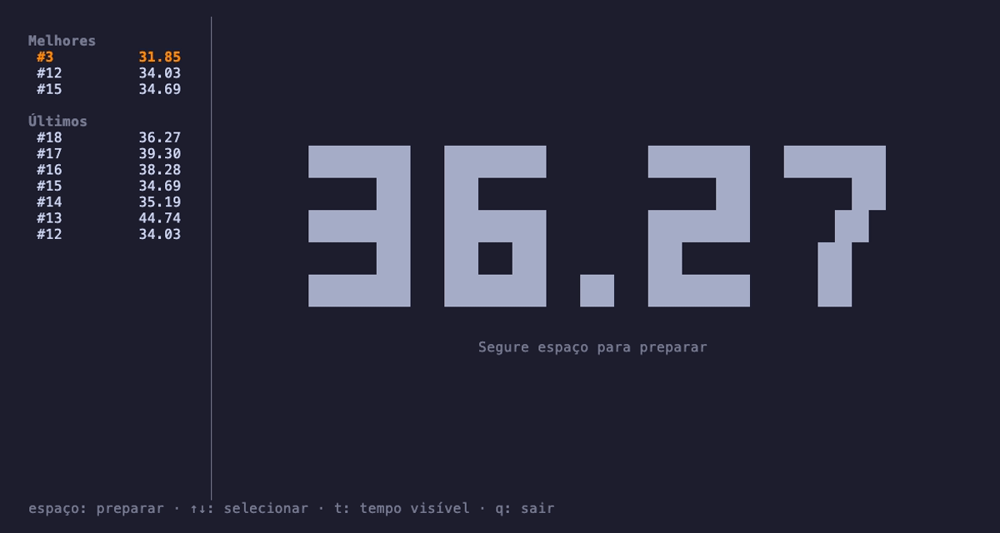

# cubo

Timer de speedcubing que roda inteiro no terminal: segure espaço, solte e resolva.



- Segurar espaço prepara (vermelho → verde após 0,5 s); soltar começa; espaço de novo para.
- Dígitos grandes no centro, que se ajustam ao tamanho do terminal.
- À esquerda, os 3 melhores tempos de todo o histórico e os 7 últimos.
- Apague um tempo inválido direto da lista.
- Opção de ocultar o tempo durante a execução, lembrada entre aberturas.
- Node puro, zero dependências.

## Instalação

Requer Node 20 ou mais novo.

```
git clone git@github.com:AllefDouglasDev/rubik-cube-terminal.git
cd rubik-cube-terminal
npm link          # instala o comando `cubo`
cubo
```

Sem `npm link`, `node bin/cubo.js` funciona da mesma forma.

## Teclas

| Tecla | O que faz |
|---|---|
| segurar espaço | prepara: vermelho, e verde após 0,5 s |
| soltar espaço | começa (soltar antes do verde cancela) |
| espaço | para e grava o tempo |
| ↑ ↓ | seleciona um tempo na lista |
| d, depois y | apaga o tempo selecionado |
| t | mostra/oculta o tempo durante a execução |
| q, ctrl+c | sai |

## Soltar o espaço

Terminais não avisam quando uma tecla é solta. O cubo pede o protocolo de teclado do kitty (Alacritty,
kitty, WezTerm, Ghostty), que manda o release de verdade. Dentro do tmux esse evento não chega, e o
cubo deduz o release pela repetição automática do teclado: quando as repetições param, o espaço foi
solto, e o início é retroagido para logo depois da última repetição. O erro fica em torno de um
intervalo de repetição (30 ms no padrão do macOS). A repetição de teclas precisa estar ligada.

## Arquivos

- Tempos: `${XDG_DATA_HOME:-~/.local/share}/cubo/solves.json`
- Configuração: `${XDG_CONFIG_HOME:-~/.config}/cubo/config.json`

`CUBO_DATA_DIR` e `CUBO_CONFIG_DIR` trocam as pastas. Os arquivos são gravados a cada tempo, com
escrita atômica; um arquivo corrompido é renomeado para `*.corrupt-<data>`, nunca sobrescrito.

## Desenvolvimento

```
npm test                     # node --test, sem dependências
vhs docs/demo/demo.tape      # regrava o GIF com um histórico de exemplo
```

## Licença

[MIT](LICENSE)
